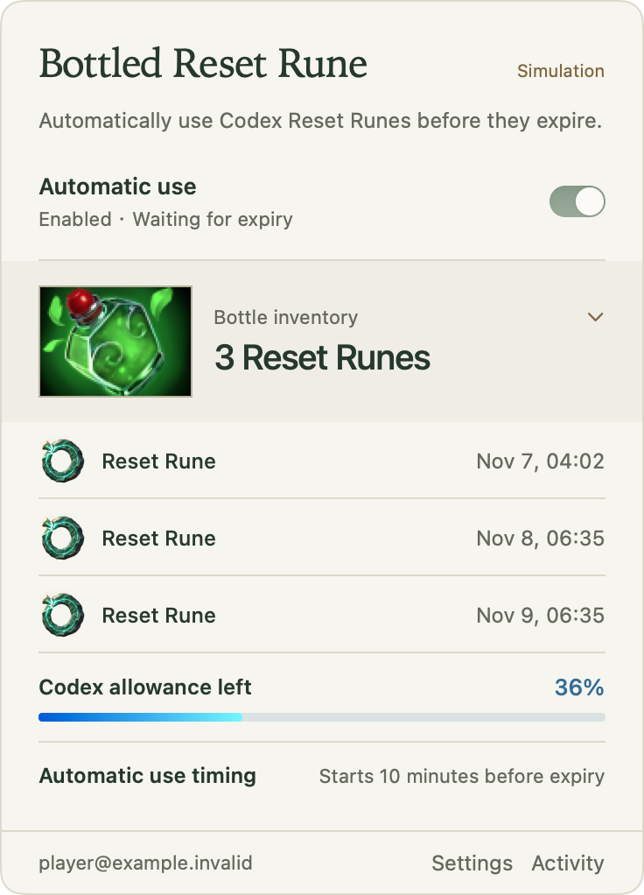

# Bottled Reset Rune

[English](README.md) · [简体中文](README.zh-CN.md)

**Turn your Codex resets into bottled runes.**

Bottled Reset Rune is a lightweight, open-source macOS menu bar utility. Each **Reset Rune** represents one spare Codex reset. The app reuses your local Codex login and, once you turn on automatic use, tries to use each rune before it expires.

The name comes from the Regeneration Rune you can store in a Bottle in Dota 2.



## Install

Requires **macOS 13 or later** and the official **Codex CLI 0.153.0**, installed and logged in.

### macOS app

- [Download for Apple Silicon](https://github.com/sufferfml/reset-rune/releases/download/v0.1.2/Bottled-Reset-Rune-0.1.2-arm64.dmg)
- [Download for Intel](https://github.com/sufferfml/reset-rune/releases/download/v0.1.2/Bottled-Reset-Rune-0.1.2-x64.dmg)

Open the DMG, drag Bottled Reset Rune into Applications, then open the app. Both versions are Developer ID signed and Apple notarized.

### npm

Requires Node.js 22 or later.

```sh
npm install -g reset-rune
reset-rune ui
```

Both installation methods open the same native macOS menu bar app.

## Get started

1. Click the bottle in the menu bar and check the displayed Codex account and workspace.
2. Turn on **Automatic use** and confirm authorization.
3. Attempts start **10 minutes** before expiry by default. Choose 5, 10, 30 or 60 minutes in settings.

Automatic use is off by default. Turn it off at any time to pause. Closing the panel or quitting the menu bar interface leaves an enabled background service running.

## Features

- **The bottle** shows how many Reset Runes you have and when the next one expires. Click the bottle to see the rune artwork and inventory details.
- **Lightweight scheduling**: A known earliest expiry is scheduled directly. Empty inventory or incomplete expiry details are checked periodically.
- **Quota and battle log**: Expand the panel to see quota, attempt timing and activity while keeping the main view compact.
- **Language and appearance**: English by default, with Simplified Chinese available. Choose system, light or dark appearance.

## Before you use it

- Your Mac must be running and online, with a valid Codex login. Sleeping or shutting down across an expiry may cause a reset to be missed. The tool does not prevent sleep or force your Mac to wake.
- Codex decides redemption eligibility, so attempts may not always succeed. The tool does not add quota or bypass limits.
- Enable automatic use on only one Mac for the same account.
- Manual refresh only reads state. If your account changes or a redemption result cannot be confirmed, the tool pauses automatic actions and asks you to check.

## Command line

```sh
reset-rune status          # View status
reset-rune refresh         # Refresh status
reset-rune pause           # Pause automatic use
reset-rune config lead 30  # Set a 30-minute lead time
reset-rune --help          # Show all commands
```

Before uninstalling, run `reset-rune uninstall-service` to remove the background service, then delete the app or npm package. Operation records and your Codex login are retained. DMG users can use the [CLI inside the app](native/README.md#运行目录与维护) (Chinese).

## Development

The `courier` branch adds task management and a version-locked path to existing Codex desktop chats. See the [compatibility record](docs/courier-compatibility.md) and [development plan](docs/courier-development-plan.md). Live message delivery has not been acceptance-tested; Claude desktop validation is deferred.

Requires Xcode / Swift 6.0+ and Node.js.

```sh
npm ci
npm test
swift test --package-path native
```

See the [native module guide](native/README.md) for building, packaging and maintenance, and the [acceptance records](docs/acceptance-matrix.md) for test coverage (both in Chinese). Use synthetic data and isolated directories for testing; do not use a real account's spare resets.

Windows support is planned and has not been released. See the [development plan](docs/windows-development-plan.md) and [technical design](docs/windows-technical-design.md) (Chinese).

## License

The project code and its custom Reset Rune illustration use the [MIT license](LICENSE). Dota 2 artwork, including the Bottle icons adapted for macOS, is excluded from that license. Valve and its licensors retain the rights to it. See the [artwork credits and sources](assets/ARTWORK.md). Bottled Reset Rune is an independent project.
