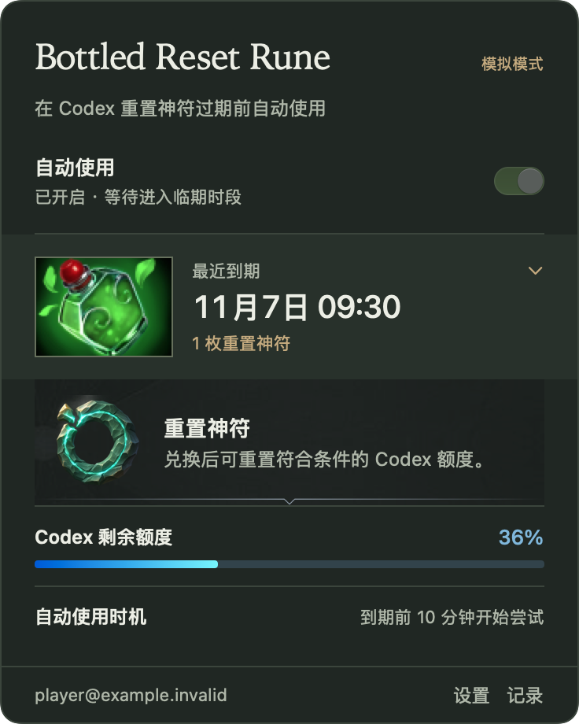

# Bottled Reset Rune

[English](README.md) · 简体中文

**把codex的重置变成神符装进魔瓶**

Bottled Reset Rune 是一款轻量、开源的 macOS 菜单栏工具。每枚**重置神符**代表一次 Codex 备用重置。应用复用本机 Codex 登录，你开启自动使用后，它会按设定的提前量尝试使用即将到期的神符。

名字取自 Dota 2 中可以装进魔瓶的恢复神符。



## 安装

需要 **macOS 13 或更新版本**，以及已安装并登录的官方 **Codex CLI 0.153.0**。

### macOS 应用

- [下载 Apple 芯片版](https://github.com/sufferfml/reset-rune/releases/download/v0.1.1/Bottled-Reset-Rune-0.1.1-arm64.dmg)
- [下载 Intel 版](https://github.com/sufferfml/reset-rune/releases/download/v0.1.1/Bottled-Reset-Rune-0.1.1-x64.dmg)

打开 DMG，将 Bottled Reset Rune 拖入“应用程序”，然后打开应用。两个版本均已通过 Developer ID 签名和 Apple 公证。

### npm

需要 Node.js 22 或更新版本。

```sh
npm install -g reset-rune
reset-rune ui
```

两种安装方式打开的都是同一个 macOS 原生菜单栏应用。

## 开始使用

1. 点击菜单栏里的魔瓶，核对显示的 Codex 账号和工作区。
2. 开启“自动使用”，确认授权。
3. 默认在到期前 **10 分钟**开始尝试，可在设置中改为 5、10、30 或 60 分钟。

自动使用默认关闭，随时关闭开关即可暂停。关闭面板或退出菜单栏界面后，已开启的后台服务仍会继续运行。

## 功能

- **魔瓶状态**显示重置神符数量和最近到期时间。点击魔瓶可查看神符图和库存明细。
- **轻量调度**：已知最早到期时间时直接安排任务；库存为空或到期信息不完整时，定期重新检查。
- **额度与战报**：在展开区域查看额度、尝试时机和使用记录，主面板保持简洁。
- **语言与外观**：默认英文，可选简体中文；支持跟随系统、浅色和深色外观。

## 使用须知

- Mac 需要保持运行、联网且 Codex 登录有效。睡眠或关机跨过到期时间可能错过使用，工具不会阻止睡眠或强制唤醒。
- 兑换资格由 Codex 决定，工具不能保证每次都能使用成功，也不会增加额度或绕过限制。
- 同一账号请只在一台 Mac 上开启自动使用。
- 手动刷新只读取状态。账号变化或兑换结果无法确认时，工具会暂停自动操作并提示检查。

## 命令行

```sh
reset-rune status          # 查看状态
reset-rune refresh         # 刷新状态
reset-rune pause           # 暂停自动使用
reset-rune config lead 30  # 改为提前 30 分钟
reset-rune --help          # 查看全部命令
```

卸载前，执行 `reset-rune uninstall-service` 可移除后台服务，再删除应用或 npm 包。操作记录与 Codex 登录会保留。通过 DMG 安装的用户可使用[应用内命令入口](native/README.md#运行目录与维护)。

## 开发

需要 Xcode / Swift 6.0+ 和 Node.js。

```sh
npm ci
npm test
swift test --package-path native
```

构建、打包与维护见[原生模块说明](native/README.md)，测试范围见[验收记录](docs/acceptance-matrix.md)。测试请使用合成数据和隔离目录，不使用真实账号的备用重置。

Windows 版本尚未发布，开发范围与里程碑见[开发计划](docs/windows-development-plan.md)，实现与验收细节见[技术方案](docs/windows-technical-design.md)。

## 许可证

项目代码与专为本项目设计的重置神符图采用 [MIT 许可证](LICENSE)。Dota 2 美术（含为 macOS 适配的魔瓶图标）排除在本项目的 MIT 授权范围之外，其权利归 Valve 及相应权利人所有。详见[美术署名与来源](assets/ARTWORK.md)。Bottled Reset Rune 是独立项目。
