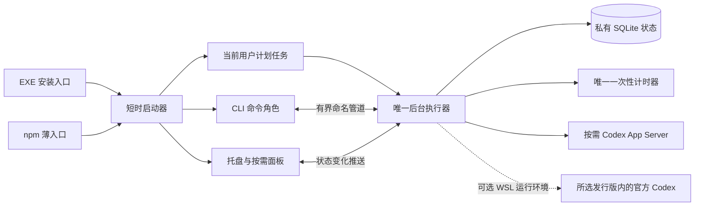

# Windows 版技术方案

状态：拟定架构，尚未实现。文档基于当前 macOS 实现和 2026-11-06 核对的官方资料。预算、API 组合和目录需要通过开发计划 P0 的 Windows 样机冻结；不能将此文当成现有 Windows 功能说明。

配套：[开发计划与验收](windows-development-plan.md) · [现有原生模块](../native/README.md) · [共享合同](../test/contracts)。

## 1. 已知基础与设计决策

### 已确认的基础

- 当前产品使用 Swift / AppKit / SwiftUI、launchd 和 macOS 文件接口；这些代码不能直接打成 Windows 可执行文件。
- 可复用的内容是业务规则、App Server 合同、合成测试向量、原创素材和双语信息结构；`test/reference` 只供验证，不是生产 Node 后台。
- 上游 Codex 0.153.0 已提供 Windows x64、ARM64 的原生程序。使用该版本的 `codex.exe app-server`，不需要自己重新实现登录或私有 HTTP 接口。[固定版本发行](https://github.com/openai/codex/releases/tag/rust-v0.153.0) · [npm 包装器](https://github.com/openai/codex/blob/rust-v0.153.0/codex-cli/bin/codex.js)

### 拟定选型

| 层 | 选择 | 原因与限制 |
| --- | --- | --- |
| 业务与 CLI | Rust，独立 Windows 工作区 | 控制常驻开销，生成原生程序；需按合同移植 Swift 核心 |
| 系统 API | `windows` / windows-rs，按需启用 Win32、COM、WinRT 绑定 | 官方 API 绑定，不引入完整桌面运行时；具体版本与 MSRV 在 P0 锁定 |
| 界面 | Win32 托盘 + 标准 HWND 控件；装饰部分绘制 | 复用系统交互与辅助功能，不做全画布 UI |
| 持久化 | `rusqlite` 的 bundled SQLite；WAL + FULL | 用事务承担关键状态持久性，不手写 Windows 文件日志协议 |
| 并发 | 单业务执行队列、独立 I/O / 系统事件处理、立即生效的发送门禁 | 保留整笔事务互斥；不能因 await 让另一笔兑换插入 |
| 本机通信 | 仅本机命名管道，显式用户 SID 权限 | Windows 首版不开放 HTTP 端口或浏览器设置页 |
| 后台托管 | 当前用户会话的 Task Scheduler 任务 | 不保存用户密码，不用 SYSTEM 服务访问另一套登录 |
| 分发 | 用户级 NSIS EXE、ZIP、npm 平台载荷 | 两渠道共享签名程序、稳定后台目录和唯一执行器 |

windows-rs 提供 Win32、COM 和 WinRT 绑定；它不是现成的 UI 框架。[官方项目](https://github.com/microsoft/windows-rs)

Tauri 使用 Windows WebView2；小安装包不等于没有浏览器运行成本，捆绑固定 WebView2 还会明显扩大包体。当前没有可复用网页界面，因此不采用该路线。C# / WPF 仍是备选，但需要把 .NET 依赖或自带运行时计入体积和部署成本。P0 若证明原生控件不能满足体验，应带实测对比重新选择，而不是无条件坚持框架。[Tauri 分发说明](https://tauri.app/distribute/windows-installer/)

## 2. 进程与模块



后台和托盘是两个长期角色；面板可见时才创建控件、解码展示图片，隐藏后释放。CLI 与安装辅助进程短时运行。托盘不执行兑换算法，退出托盘不等于停止后台。官方 Codex 只在读取或兑换事务中短时启动，不全天保活。

拟定文件结构，尚未创建实现目录：

```text
windows/
  Cargo.toml / Cargo.lock / rust-toolchain.toml
  crates/
    rune-core/          # 业务状态、授权、调度和共享向量
    codex-transport/    # 官方进程、JSONL、账号与库存归一化
    rune-storage/      # SQLite、状态校验和故障注入
    rune-platform/     # SID、管道、锁、任务、时钟、电源、通知、Job Object
    rune-app/          # CLI / worker / tray 角色与 Win32 面板
    rune-launcher/     # 短时稳定入口及程序激活
  packaging/           # 用户级安装脚本、manifest、ICO 与许可
  tests/               # Windows 合同、平台与交付测试
scripts/
  package-windows.*
  verify-windows-artifacts.*
  smoke-windows-lifecycle.*
```

不创建另一份 Windows npm 后台或 WSL 定时服务。macOS 继续使用现有 `native/`；共享的是合同与测试材料，不是一个需要同时替换两个平台的底座。

## 3. 业务合同与兑换事务

Windows 与当前核心保持以下语义：

1. 默认关闭；确认绑定身份和提前量后才能开启。读取、UI 展示、调度时间提示都不授予兑换权。
2. 每笔兑换固定原 credit ID、UUID 幂等键、身份、开始和到期时间。
3. 读取当前账号与库存，检查目标、资格、时间和授权；持久化 `intent` 成功后，才允许进入最终预检和发送。
4. 发送前再次核对身份与立即门禁。`notSent` 只用于能证明没有发送的情况；部分写出、超时、进程被终止均不能冒充未发送。
5. `reset` / `alreadyRedeemed` 先提交成功回执和 `reset-unverified` 状态，再重读额度，不能为了刷新成功才承认已使用。
6. 普通首次请求的 `nothingToReset` / `noCredit` 分别处理，不换另一张连续尝试。恢复一笔曾经可能发出的请求时，负面结果也不能抹去原不确定性。
7. 恢复只用原目标和原键；明确 `unconfirmed` 时停止自动调度，不能删除记录或新建键继续兑换。
8. 暂停 / 关闭先使内存发送门禁失效，再排队持久化配置；只有提交成功才向 UI 确认持久化结果。失败时保持当前进程阻断，并显示错误。

暂停写入失败时，将计划任务置为隔离状态、抑制自动重启并回读确认；下次显式启动须先处理隔离原因、重新确认，不能读取旧 `enabled=true` 就解除阻断。系统侧阻断也失败时，明确显示“暂停未保存，跨重启无法保证”，提供停止后台的处理入口；内存门禁不能被描述成掉电后仍有效的暂停。

这些要求来自当前 [Engine](../native/Sources/RuneCore/Engine.swift)、[State](../native/Sources/RuneCore/State.swift) 与共享用例。不能因更换语言、数据库或 IPC 放宽。

OpenAI 的 consume API 允许省略目标，但本产品始终传明确 `creditId`，避免服务端选择另一张；相同逻辑请求的重试复用原 UUID。模拟响应和官方合同均不能证明线上低使用量时必定允许兑换。[官方合同](https://learn.chatgpt.com/docs/app-server#8-earned-rate-limit-resets-chatgpt)

### 跨语言一致性

- 核心状态对象继续使用现有 v1 JSON 合同；Windows 平台设置放在独立表，不向 macOS 严格配置模型插入未知字段。
- 账号、scope、授权摘要、同 ID 比较及库存版本必须通过现有非 ASCII、组合字符、大小写和整数向量。
- 不直接以 Rust UTF-8 字典序、系统语言排序或 Unicode 规范化替代现有语义。尤其库存摘要涉及既有 ICU 英文排序，P0 必须决定并验证等价实现及其包体成本。
- 若相同摘要需要引入较大的 ICU 数据依赖，先给出实测。不能为省包体静默改摘要；确需合同改版时单列版本和变更设计。
- 比较核心状态和消费参数时，可排除平台独有运行指标，不能排除授权、未决记录和结果差异。

## 4. Codex 发现、登录与进程

### 原生 Windows

发现顺序：明确配置的 `RESET_RUNE_CODEX_PATH` → 已记录且指纹仍有效的路径 → PATH 和已知官方安装位置。入口必须解析到可信的绝对 `.exe`，并执行兼容版本检查；路径或文件变化后重新验证。

npm 的 `codex.cmd` 是包装入口，不能直接当原生程序交给 `CreateProcessW`。参考官方包装器找到匹配架构的平台包与 `vendor/<target-triple>/bin/codex.exe`；未知安装布局可由用户选择路径，不用 `cmd.exe /c` 执行猜测的 shim。

通过 `codex.exe app-server` 使用 stdio JSONL。启动参数、初始化能力、方法白名单、帧限制和错误归一化与固定版本对齐。每帧上限 1 MiB，读写、RPC 和收尾均有超时及输出上限；未请求的服务端方法不能触发模型任务或任意命令。[固定版本协议](https://github.com/openai/codex/blob/rust-v0.153.0/codex-rs/app-server/README.md)

Windows 子进程使用正确的 UTF-16 参数编码、绝对工作目录与有意选择的环境变量，不拼接 shell 命令。不传入 API key 来代替 ChatGPT 登录，不输出原始 RPC、stderr、环境或认证 URL。版本缺失或不兼容时停止自动使用并说明，不悄悄替换用户的 Codex。

仅将本工具创建的进程加入 Job Object，设置关闭句柄时回收自有进程树；创建和纳管之间避免子进程逃逸窗口。不得终止用户已有 Codex / DSH 会话。回收成功也不代表最后一笔请求没有发送。[Job Objects](https://learn.microsoft.com/en-us/windows/win32/procthread/job-objects)

### 登录复用

原生 Windows 默认 Codex home 为 `%USERPROFILE%\.codex`；使用与用户相同的 SID 和其明确选中的 `CODEX_HOME`，由官方 Codex 自行处理登录文件和凭据库。本工具不打开 `auth.json`、不读取 Windows Credential Manager、不复制 token、不实现第二套 OAuth。

首次选择来源时解析并保存该环境内的绝对 Codex 路径和绝对 `CODEX_HOME`，后续由后台从这些非凭据设置构造子进程环境。不能依赖打开 GUI / CLI 的终端临时 PATH、`CODEX_HOME` 或计划任务执行参数中的环境变量展开；修改 home 和程序来源均递增来源代次并要求重新核对身份。[计划任务执行环境](https://learn.microsoft.com/en-us/windows/win32/api/taskschd/nn-taskschd-iexecaction#remarks)

“无需再次登录”只在该执行环境已有可复用登录时成立。官方凭据可能采用文件、系统凭据库或进程内临时存储；临时登录不能承诺被另一个进程复用。提示用户在官方 Codex 中登录，不让其把密码、token 或验证码填进本工具。[凭据存储](https://learn.chatgpt.com/docs/auth#credential-storage)

### WSL2 扩展

WSL 适配解决登录和运行时所在的位置，不负责截获 DSH 消耗。同一账号、工作区、额度池的用量，即使产生于 WSL，也可以被已登录同池的原生 Codex 读到。

- 默认选择原生 Windows。只有用户需要 WSL 中的登录时，才在展开设置中选择明确发行版和该环境内的 Codex。
- 由 Windows 唯一后台通过 `wsl.exe --distribution <明确发行版> --user <明确Linux用户> --exec <明确入口>` 启动官方 stdio；发行版来自枚举，用户及路径在对应环境内解析和验证，不能静默取第一个发行版或随默认用户变化。
- `--exec` 不加载用户 shell profile；不能期待 `.bashrc` / `.zshrc` 中的 `CODEX_HOME` 自动生效。保存明确的 Linux 用户、环境内绝对 home 与程序路径，使用受控的环境注入方式启动，不执行任意 profile；默认用户变化要检测并提示，不能悄悄读取另一身份。[WSL 命令与用户](https://learn.microsoft.com/en-us/windows/wsl/release-notes#build-18305) · [环境变量互通](https://learn.microsoft.com/en-us/windows/dev-environment/wsl-interop#environment-variable-sharing)
- 原生和 WSL 的 home、系统凭据库及规范化路径可能不同，不能靠指向同一个物理目录保证免登录。禁止自动复制或同步认证文件。[官方 Windows / WSL 说明](https://learn.chatgpt.com/docs/windows/windows-app#share-config-auth-and-sessions-with-wsl)
- 切换运行环境立即暂停，核对身份并重新确认；有未确认操作时不能通过换环境清障。平台保存来源代次，防止旧预检在来源已切换后发送。
- WSL 不安装另一个定时兑换器，不常驻保活发行版。查询可能冷启动 WSL，须把 VM 与进程成本单列。
- 必须验证发行版内自有 PID / 进程组的定向回收与断管退出；不能以结束 `wsl.exe` 推断 Linux 子进程已退出，更不能调用 `wsl --shutdown` 清理。

## 5. 调度、电源和网络

| 状态 | 下一任务 |
| --- | --- |
| 已确认完整最早库存，远离临期 | 仅预约 `expiresAt - lead`，周期远程读取为零 |
| 空库存 / 最早项无法确认 | 默认 30 分钟发现；已有已知目标时不得晚于其尝试窗口 |
| 临期但满额 / 尚不具备资格 | 60 秒有界观察；额度版本未变不重复提交同一负面请求 |
| 普通读取错误 | 1 / 2 / 5 / 15 / 30 分钟退避，临期等待上限 60 秒；上游明确等待要求优先 |
| 已发出未决意图 | 最早 30 秒后按原目标和键恢复，仍受实际到期和门禁约束 |
| 明确结果未确认 | 不安排自动恢复到下一目标 |
| 用户暂停 | 不安排周期任务；手动刷新仍只读 |

完整库存需权威总数、唯一 ID、有效到期及数量相符。条目截断或只有总数不能被当成完整最早项。新增重置不会早于已知最早项到期是本产品调度前提；空库存低频发现并非覆盖任意短时新卡的保证。

后台只保留一个可重排的一次性计时器，业务存储使用 UTC 毫秒；等待、时钟跳变和恢复要分别处理。Windows 相对计时在低功耗状态下的行为不能被当作绝对到期保证。采用普通 waitable timer，周期为零，不请求恢复唤醒、不使用高精度全局计时或电源保持锁；唤醒 / 时间变化后重算并在发送前再次检查实际 UTC。[SetWaitableTimerEx](https://learn.microsoft.com/en-us/windows/win32/api/synchapi/nf-synchapi-setwaitabletimerex)

系统事件只触发已到期或此前失败的任务；远期任务遇到网络恢复不立即查询。网络连接事件只表明可以尝试，不等于 OpenAI 可达。并发的唤醒、网络、手动刷新和定时信号合并处理，不能积压重复请求。睡眠或关机跨过期限可能错过，禁止通过阻止睡眠掩盖这一边界。

## 6. 持久化与损坏处理

选择本机 SQLite 单连接、单写者、WAL + `synchronous=FULL`。Rust 通过 bundled SQLite 固定引擎版本，不依赖用户安装数据库服务。SQLite 的 WAL / FULL 在提交时进行同步；NORMAL 不能作为本产品的掉电持久性承诺。[SQLite WAL](https://www.sqlite.org/wal.html) · [同步语义](https://www.sqlite.org/pragma.html#pragma_synchronous) · [rusqlite bundled](https://github.com/rusqlite/rusqlite)

锁定的 SQLite 必须包含官方 WAL-reset 缺陷修复，不采用已知受影响版本；官方列出 3.51.3 及之后版本或相应回移修复。即使本产品只有单写连接，也不能省略依赖安全核对。[官方缺陷说明](https://www.sqlite.org/wal.html)

拟定存储：

- `state`：单行核心 v1 状态 JSON、revision 和更新时间。每次关键状态迁移在一个事务内写入，提交成功后再发送或发布成功状态。
- `platform_settings`：原生 / WSL 来源、绝对程序及 home 路径、发行版、Linux 用户、来源代次等非凭据信息；不污染核心配置合同。
- 数据库 schema 通过 `user_version` 管理。运行包声明兼容 schema 范围，回退前检查；不兼容时拒绝程序回退，不恢复旧数据库代替。

核心执行队列独占数据库连接；IPC 和事件接收不得被磁盘 I/O 卡住。暂停请求在进入业务队列前关闭原子门禁；GUI 只有在配置事务成功后才显示已保存。设置合理的 busy timeout、缓存和 WAL checkpoint 上限，并在 P0 实测；无周期数据库轮询或后台反复 vacuum。

磁盘满、只读、SQL 错误、同步失败、状态校验失败均阻断发送，保留原文件和诊断信息。不能删库重建空状态继续自动使用。备份必须使用一致性数据库备份方法，不能只复制 `.db` 漏掉 WAL；程序升级和回退都不自动恢复旧业务快照。

不以 `ReplaceFileW` 的原子文件替换宣称已经解决掉电持久性；其 `REPLACEFILE_WRITE_THROUGH` 标志官方明确不受支持。运行包指针仍可使用替换和校验，但兑换日志使用上述事务设计。[ReplaceFileW](https://learn.microsoft.com/en-us/windows/win32/api/winbase/nf-winbase-replacefilew)

## 7. 用户身份、锁与本机通信

数据根目录拟为 `%LOCALAPPDATA%\Bottled Reset Rune`，通过 Windows Known Folder API 解析，不拼接猜测用户名。正式状态、模拟状态、运行包、日志分目录；模拟任务、锁、管道与数据库必须全部独立。

使用跨会话的每用户文件独占锁约束执行器，另一把生命周期锁约束安装 / 激活写者。任务计划程序的 IgnoreNew 只是额外防重，不替代自己的单实例保护。GUI 与 CLI 不直接修改数据库。

这些锁只覆盖本机同一用户的本产品后台，不能协调另一台 Windows、Mac 或 WSL 内独立安装的执行器。同一账号和额度池只在一台设备开启自动使用；本期不增加云端互斥，也不能把单笔 UUID 幂等误当成跨设备保护。

命名管道拟为 `\\.\pipe\reset-rune.<SID摘要>.v1`，模拟管道另加 `.mock`：

- 显式 DACL 仅允许当前用户及必要系统主体；不使用默认安全描述符，不授予 Everyone / Anonymous。默认管道 ACL 并非用户私有。[Microsoft 说明](https://learn.microsoft.com/en-us/windows/win32/ipc/named-pipe-security-and-access-rights)
- 首个服务端实例使用 `FILE_FLAG_FIRST_PIPE_INSTANCE`，拒绝远程客户端；检查对端身份、服务端 PID 与受信运行路径，管道被占用时失败关闭，不连接未知执行器。[CreateNamedPipeW](https://learn.microsoft.com/en-us/windows/win32/api/namedpipeapi/nf-namedpipeapi-createnamedpipew)
- 使用带版本、request ID 和长度的有界 JSON 帧；建议单帧最大 1 MiB、单连接积压和超时有上限。操作仅包含状态、配置、确认绑定、刷新和生命周期所需方法，不提供任意执行 / 文件访问。
- 订阅按 revision 推送，慢客户端有界合并或断开；不使用固定心跳、文件监视轮询或每秒状态请求。
- 数据目录和文件验证所有者与 ACL；检查 reparse point、链接和意外共享位置。拒绝 UNC、网络盘和未经验证的同步目录作为数据库根目录。

威胁边界是本机用户隔离及防意外双执行，不能宣称能阻止管理员或同一用户下任意恶意程序。状态包含账号展示信息和操作记录，日志默认脱敏且不含认证凭据。

## 8. 任务计划程序与生命周期

注册当前 SID 的交互式用户任务，使用最低权限和 `InteractiveToken`；不保存密码，不注册机器级服务。工作进程与用户的 Codex 使用相同身份。

| 设置 | 拟定值 / 语义 |
| --- | --- |
| 登录触发器 | 仅“登录时启动”开启时添加；默认关闭 |
| 按需启动 | 开启；用户打开应用或运行 start 时可启动后台 |
| ExecutionTimeLimit | `PT0S`，避免默认 72 小时后被停止 |
| DisallowStartIfOnBatteries / StopIfGoingOnBatteries | 均 false；不因电池条件意外失去保护 |
| RunOnlyIfIdle / RunOnlyIfNetworkAvailable | 均 false；由产品管理网络退避 |
| WakeToRun | false，不安排强制唤醒 |
| MultipleInstances | IgnoreNew，再加产品自身跨会话锁 |
| RestartOnFailure | 有界退避和次数；只对意外失败，不用于反复消除损坏状态 |

上述默认时限、电池行为须显式覆盖并回读任务 XML，不能只看注册成功。[执行时限](https://learn.microsoft.com/en-us/windows/win32/taskschd/tasksettings-executiontimelimit) · [电池设置](https://learn.microsoft.com/en-us/windows/win32/taskschd/tasksettings-disallowstartifonbatteries)

`pause` 立即禁止后续发送并持久化暂停；`stop` 先抑制任务重启，再请求后台正常退出并回收自有子进程；`start` 显式恢复任务可运行状态。关闭托盘只关闭界面。登录启动关闭后不得留下其他 Run 注册表或启动文件夹入口继续自启动。

任务被企业策略禁用时显示明确状态，不自动要求管理员权限，不另建不可见的备用启动器。用户注销后不承诺继续保护；电脑关机或睡眠期间不承诺执行。

## 9. 界面与通知

面板约 368 DIP，沿用魔瓶、石材、铜色和绿色符文。Windows 采用自己的托盘定位、字体和控件习惯，不复制 macOS 窗口按钮或系统字体假设。

- 主界面仅显示用途说明、自动使用、最近到期 / 次数和账号；明细、设置、战报就地互斥展开。
- 菜单栏对应 Windows 通知区域；有符图标采用明显填充，空瓶使用轮廓，未知增加符号，并配可读 tooltip，不依赖细小旋纹或颜色差异。
- 按钮、选择框和焦点保留真实控件语义；魔瓶、蓝量条、分隔装饰可绘制。深色绘制不得依赖未文档化的系统函数序号；必要的控件绘制仍保留键盘及辅助功能角色。
- 默认 English，可选简体中文；外观 System / Light / Dark。高对比与系统可访问性优先于主题装饰；切换设置不修改自动使用授权。
- 覆盖 Tab / Shift+Tab、Space、Enter、Escape、焦点返回、Narrator、200% 文字放大、多屏及 100–300% DPI。Explorer 重启后重建托盘图标，避免丢失入口。
- 隐藏时释放面板和大图解码，无常驻动画、秒表或重复“读取于”标签。
- Toast 使用系统通知能力，不另带通知框架运行时。普通提醒只显示必要结果，不在锁屏泄露邮箱。通知失败不能改写已确认回执；关闭通知也不能影响调度。

通知的 AUMID、当前用户快捷方式和激活注册需要在 P0 / P3 核实。激活只允许打开产品界面，不接受任意 shell 参数；退出托盘时后台通知仍应按设置工作。

## 10. 安装、升级、回退和分发

### 共享稳定运行包

原始程序来自 EXE、ZIP 或 npm 时，都先验证签名与清单，再复制到用户私有的不可变版本目录，例如 `runtime/versions/<版本-架构-构建摘要>`。短时启动器通过经过校验的 current 指针选择版本；后台计划任务不指向 npm 包目录、下载目录或临时安装目录。

签名验证须匹配本产品明确允许的发布者身份及证书轮换策略，不能只接受任意可信 CA 签名。清单同时核对产品 ID、版本、架构、完整文件列表与每项哈希，拒绝缺失、额外或被替换的文件；证书轮换需通过受信发行记录明确授权，不能从待安装载荷自行取得新的信任根。

安装 / 激活流程在生命周期锁内执行：验证载荷 → 进入维护门禁 → 等待已有事务明确完成或持久化不确定状态 → 停止自有后台 → 完整复制并核验新版本 → 提交程序指针 → 启动并检查本机健康。过程中保留原程序以恢复启动，不能恢复旧业务数据库。正在运行的 EXE 被 Windows 锁定时，不覆盖它本身，采用新版本目录切换。

程序指针损坏时只枚举签名有效、schema 兼容的已验证候选，不启动任意目录；恢复前读取最新 journal。超时或失败不意味着可以抹去未决操作。只保留当前与一个可回退版本，清理时跳过正在使用的文件。

### 渠道

| 入口 | 拟定产物 / 行为 |
| --- | --- |
| GitHub | `Bottled-Reset-Rune-<version>-x64-setup.exe`、对应 ZIP；ARM64 阶段提供原生同类产物 |
| 用户级安装 | NSIS `RequestExecutionLevel user`；当前用户程序目录、快捷方式和卸载注册；不写机器级 PATH |
| npm 主包 | `reset-rune`，新增 win32 分发选择，不改变 darwin 行为；Node 只作为安装及短时启动入口 |
| npm 平台包 | `reset-rune-win32-x64`、`reset-rune-win32-arm64`；只放匹配架构的签名载荷和许可 |
| 兼容 CLI | `reset-rune ui/status/refresh/pause/...`；内部 `.exe` 使用参数数组启动，不拼 shell |

NSIS 安装与卸载均设置当前用户上下文；相同构建的 EXE、ZIP 和 npm 原生文件哈希应一致。安装器自身与所有可执行文件做 Authenticode 签名和时间戳，不能在签名后更改资源。[用户级执行权限](https://nsis.sourceforge.io/Reference/RequestExecutionLevel)

签名身份在开发期间准备，可评估适用于开源项目的服务；资格另核。签名与 SmartScreen 文件信誉不同，不能保证“签完就没有提示”，不指导用户关闭 Defender / SmartScreen。[Microsoft 说明](https://learn.microsoft.com/en-us/windows/apps/package-and-deploy/smartscreen-reputation)

### 卸载与更新边界

`uninstall-service` 先停止后台并移除本产品的任务 / 通知激活注册，再清理程序运行包，默认保留状态记录和 Codex 登录。EXE 卸载器调用同一生命周期逻辑。npm 用户明确先卸载后台再执行 npm uninstall；没有隐藏生命周期脚本替用户消费或删除状态。

保留数据时，后续重新安装不得仅因发现旧 `enabled=true` 就在用户不知情下恢复保护；应有已持久化的卸载 / 重新确认状态，并保留未决记录。彻底删除数据需另行明确选择，不作为默认卸载动作。本期不做静默联网自更新；用户可安装新版本并执行受控激活。

## 11. 验证、资源与构建

### 必须覆盖的自动化

- 核心差分：所有现有向量，新增 Windows 存储结果和来源切换向量；不得使用真实备用重置。
- 协议：合成 `.exe` App Server、启动失败、路径有空格 / 中文、超时、超大帧、错误消息、账号变化、目标缺失及四类结果。
- 存储：在意图提交前后、发送前后、回执提交前后分别杀进程；磁盘满、同步失败、只读、损坏、WAL 恢复及断电级故障注入；重启不产生新键重发。
- 平台：非管理员、不同用户、同用户多会话、管道抢占、坏 ACL / 链接、重复入口、计划任务被禁用、登录启动关闭、电池切换及超过默认时限；临时终端环境退出后后台重启仍使用明确的 home。
- 生命周期：EXE → npm、npm → EXE、并发启动、来源程序移除、升级失败、回退 schema 不兼容、卸载后重装、暂停写入失败及隔离，均不能恢复旧操作记录或偷偷重启已卸载后台；伪造发布者和清单额外文件必须拒绝。
- UI：中英文、深浅色、系统高对比、Narrator、键盘、长账号、三种库存、相同时间的多张卡、不完整明细、未知结果及多屏 DPI。
- WSL：选择不同发行版、只有 WSL 登录、同池 DSH 用量、冷启动、发行版停止、定向收尾；仅 shell profile 设置 home、默认 Linux 用户变化均有明确处理，用户其他 WSL 任务保持运行。

CI 负责单元 / 合同、构建、PE 依赖、许可、文件清单和签名核验。实际 Windows 11 交互会话、睡眠、通知及托盘测试使用专用虚拟机 / 真机，不用 SYSTEM 身份的服务器 runner 冒充用户桌面验收。ARM64 必须补原生设备证据。

### 资源统计

预算见开发计划。报告后台和托盘各自及合计的 Private Bytes、Working Set、CPU 时间、线程 / 句柄、计时唤醒、远程调用次数和落盘次数；查询阶段另列官方 Codex 及其后代进程，WSL 冷启动与 VM 影响单列。

使用 Windows 性能计数与 ETW / WPR 等适当工具。先完成 30 分钟空闲和 24 小时合成观察，再做跨 72 小时运行抽查；关窗后不应保留图像缓存或出现固定间隔请求。零次采样 CPU 增量只能报告该观察精度，不能称为绝对零能耗。

发布用固定 Rust 工具链、Cargo.lock、Windows SDK / MSVC 和可追溯构建镜像。检查所依赖 CRT / DLL 的实际分发条件，不能只展示主 EXE 大小而隐藏运行时下载。生成 SBOM、第三方许可、源文件清单、完整包体与 SHA-256；私钥只在受控签名环境，不进入仓库或普通 PR 构建。

### 放行与尚待验证

先完成计划中的 x64 完整版，再分别放行 ARM64 与 WSL2。每项预算、掉电保证、辅助功能和系统事件都以实际回执为准。当前尚无 Windows 构建、安装、资源或真实登录联调证据；官方二进制存在及模拟合同正确不等于 Windows 产品已交付。
